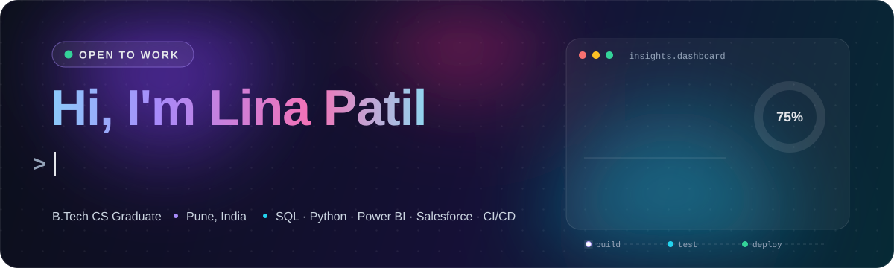

<div align="center">



<br/>

<a href="https://www.linkedin.com/in/lina-patil-513a15237"></a>
<a href="mailto:linaapatill09@gmail.com"></a>
<a href="https://github.com/Linaapatil/HMS-Salesforce"></a>


</div>


## 👩‍💻 About me

<table>
<tr>
<td width="55%" valign="top">

I turn messy data into clean, actionable insights, and I build the systems that produce that data in the first place.

- 📊 **Data Analyst**: SQL, Python, Power BI and Tableau, always chasing the story behind the numbers
- ☁️ **Salesforce Developer**: Apex, Lightning Web Components, Flows and secure data models
- ⚙️ **DevOps**: Git workflows, CI/CD pipelines, containers and automated testing
- 🌐 **Full-Stack**: Next.js, React, Node and MongoDB apps shipped to the web
- 🌱 Currently levelling up in **cloud deployments and Salesforce DevOps**

</td>
<td width="45%" valign="top">

```python
class LinaPatil:
    location  = "Pune, India"
    education = "B.Tech, Computer Science"
    roles     = ["Data Analyst",
                 "Salesforce Developer",
                 "DevOps Enthusiast"]
    latest    = "MedCare HMS on Salesforce"

    def mission(self):
        return "data → insight → impact"
```

</td>
</tr>
</table>


## 🏥 Latest project: MedCare HMS

<a href="https://github.com/Linaapatil/HMS-Salesforce">
  
</a>

A complete **Hospital Management System on Salesforce** that takes a 500-bed multi-specialty hospital from spreadsheets and paper forms to one Lightning app.

<table>
<tr>
<td width="50%" valign="top">

**🧑‍⚕️ Patients and doctors**<br/>
Screen-flow registration with unique Patient IDs, Inpatient / Outpatient / Emergency record types, doctor directory and senior → junior hierarchy.

**📅 Smart appointments**<br/>
Conflict detection, 8 AM–8 PM slot validation, Path stages, and confirmation, reminder and cancellation emails.

**💳 Billing**<br/>
Auto-pricing from procedures, discounts and insurance, plus a two-step emergency approval above ₹1L / ₹5L.

</td>
<td width="50%" valign="top">

**⚡ Apex and async**<br/>
One trigger per object with handlers, Batch, Schedulable, Queueable and `@future` jobs, all bulkified.

**🔌 Integrations**<br/>
REST lab callout via Named Credential, SOAP insurance verification, and an Apex REST API for external EHRs.

**🔐 Security and insights**<br/>
Profiles, permission sets, OWD and sharing rules, FLS, plus matrix and summary reports and an admin dashboard.

</td>
</tr>
</table>

<details>
<summary><b>🎬 Watch the live walkthrough</b></summary>
<br/>
<p align="center">
  
</p>
<p align="center">
  
</p>
</details>

<p align="center">
  <a href="https://github.com/Linaapatil/HMS-Salesforce"></a>
</p>


## 🚀 More projects

<table>
<tr>
<td width="50%"><a href="https://github.com/Linaapatil/job-market-analytics"></a></td>
<td width="50%"><a href="https://github.com/Linaapatil/customer_behavior_analysis"></a></td>
</tr>
<tr>
<td width="50%"><a href="https://github.com/Linaapatil/zepto-sql-data-analysis"></a></td>
<td width="50%"><a href="https://virtux-theta.vercel.app"></a></td>
</tr>
</table>

<p align="center">
  <sub>Also on GitHub: <a href="https://github.com/Linaapatil/Mern-stack-Project-">MERN Stack App</a> · <a href="https://github.com/Linaapatil/Slider">Infinite Slider (HTML · CSS · JS)</a> · <a href="https://github.com/Linaapatil/Virtux">Virtux source</a></sub>
</p>


## ⚙️ DevOps



<div align="center">


| Practice | How I use it |
|:--|:--|
| 🔀 **Version control** | Git branching, pull requests and clean commit history on every project |
| 🔁 **CI/CD** | GitHub Actions pipelines that lint, test and deploy on push |
| 🐳 **Containers** | Docker images for reproducible dev and deploy environments |
| ☁️ **Salesforce DevOps** | SFDX source-driven development, Apex + Jest test gates, metadata deploys |
| 🚀 **Cloud deploys** | Next.js apps shipped to Vercel; currently exploring AWS |

</div>


## 🛠️ Tech stack

<div align="center">

**📊 Data and analytics**<br/><br/>

<br/>


<br/><br/>

**☁️ Salesforce**<br/><br/>


<br/><br/>

**🌐 Web development**<br/><br/>


</div>


## 📜 Certifications

<div align="center">


</div>


## 🐍 Contribution activity

<picture>
  <source media="(prefers-color-scheme: dark)" srcset="https://raw.githubusercontent.com/Linaapatil/Linaapatil/output/github-snake-dark.svg"/>
  <source media="(prefers-color-scheme: light)" srcset="https://raw.githubusercontent.com/Linaapatil/Linaapatil/output/github-snake.svg"/>
  
</picture>

<div align="center">

## 📬 Let's connect

<a href="https://www.linkedin.com/in/lina-patil-513a15237"></a>
<a href="mailto:linaapatill09@gmail.com"></a>
<a href="https://github.com/Linaapatil"></a>


</div>
